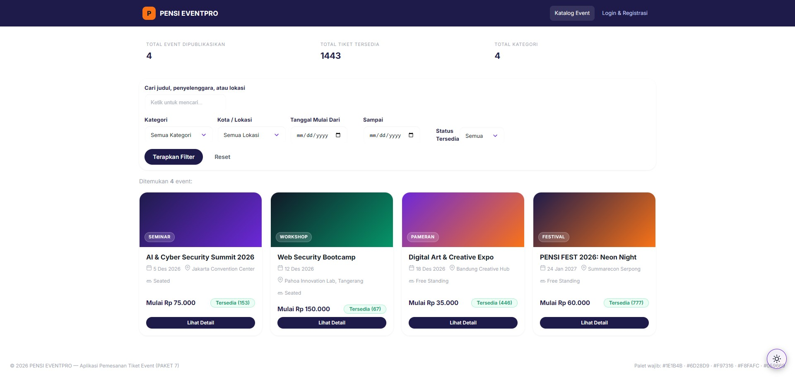
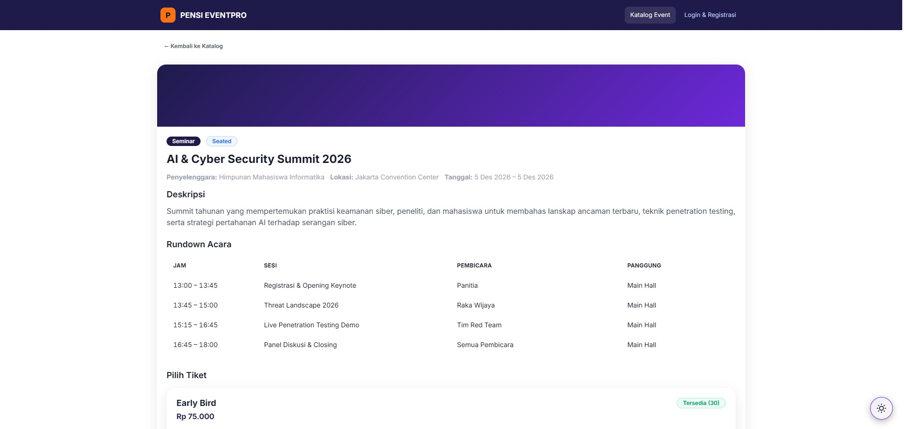

# PENSI EVENTPRO

**Multi-event ticketing platform for Sekolah Terpadu Pahoa — PAKET 7, Informatics final project.**

Native PHP 8.2 + MySQL/MariaDB. No framework, no Composer, no build step.

**Live site:** [https://pensi2026.gt.tc/](https://pensi2026.gt.tc/)



## What it does

PENSI EVENTPRO handles the full ticket lifecycle for school events:

- Public event catalogue with search, category, city, date and availability filters
- Seated events with an interactive seat map; free-standing events with quantity selection
- Server-side price calculation, promo vouchers, and a service fee per ticket
- 15-minute payment window with automatic expiry and seat/quota release
- Payment proof upload, finance verification, and e-ticket issuance
- E-ticket generation as JPG boarding pass or PDF, with HMAC-signed barcode
- Gate check-in with anti-passback and a clear “TIKET SUDAH DIGUNAKAN” result
- Role-based dashboards for customer, event organizer, finance and gate officer
- Audit log for sensitive actions

### Mandat CEO

| Mandate | Implementation |
|---|---|
| Market segmentation | Customer, event organizer, finance, gate officer roles with server-side RBAC |
| One-to-many ticket codes | One booking produces one e-ticket per attendee, each with its own code and seat |
| 15-minute auto-expiry | Pending orders expire server-side; seats and quota are released transactionally |
| Gate anti-passback | A ticket can be checked in once; repeat scans are rejected |

## Screenshots

| Event detail and seat selection | Login and registration |
|---|---|
|  |  |

## Tech stack

- PHP 8.2+ with PDO MySQL
- MariaDB / MySQL
- Apache with `mod_rewrite` and `mod_headers` (InfinityFree uses an openresty edge in front)
- Vanilla JavaScript and a custom CSS design system
- No external PHP dependencies

## Quick start (XAMPP)

1. Copy the project so that `public/` is the DocumentRoot, or use the provided localhost layout.
2. Create a MySQL database and import your schema/demo data.
3. Copy `config.local.example.php` to `config.local.php` and fill in the database credentials.
4. Make `storage/` writable by PHP.
5. Open `http://localhost/`.

For the flat web layout, `htdocs/` is the DocumentRoot and `config.local.php` sits beside it.

## Security

This version was hardened after an independent source audit. The application code now includes:

- Prepared statements with native prepares and no string-built SQL
- Contextual HTML escaping for every database value
- CSRF tokens on every state-changing POST, including logout
- bcrypt cost 12 with a rehash path and timing-equalised unknown-user check
- Session hardening: `HttpOnly`, `SameSite=Strict`, `Secure` behind TLS, strict mode, ID regeneration
- Owner/admin/finance allow-list on e-ticket downloads; gate officers cannot fetch arbitrary PII
- Atomic voucher decrement, guarded against concurrent checkout
- Per-account and per-IP login throttling; registration throttling
- Upload MIME sniffing, extension allow-list, random names, dimension limits, and storage outside the webroot
- CSP, HSTS, `X-Frame-Options`, `nosniff`, `Referrer-Policy`, and `Permissions-Policy`
- Internal directories, SQL dumps, test harnesses, installers and documentation removed from the deployed webroot

See [`SECURITY.md`](SECURITY.md) for the deployment checklist and residual notes.

## Verification

- PHP syntax check on every file
- Functional tests: catalogue, login, dashboard, checkout, proof upload, finance verification, e-ticket, gate check-in
- SQL injection probe with sqlmap against the local application: **no injectable parameter found**
- Gate IDOR test: gate account requesting another customer’s e-ticket returns **403**
- CSRF-less POST and logout GET rejected
- Sensitive paths (`src/`, `database/`, `tests/`, config, storage) return **403**
- Live browser check after deployment: catalogue, detail, login and admin dashboard load correctly

## Project layout

```
.
├── assets/            CSS design system, themes and JavaScript
├── src/
│   ├── Config/        PDO connection and application constants
│   ├── Middleware/    Auth, RBAC, CSRF, uploads, voucher and ticket helpers
│   └── Views/         Shared layout and 403 page
├── storage/           Runtime secrets and logs (not web-accessible)
├── uploads/           Payment proof storage policy (served through bukti.php)
├── docs/              Screenshots and audit report
├── *.php              Public pages and role dashboards
├── .htaccess          Security headers and directory denies
└── config.local.example.php
```

## Notes

- `config.local.php`, `storage/barcode_secret.key`, uploaded proofs and logs are intentionally ignored by Git.
- The demo database and seed script are kept outside the deployed webroot. Do not publish SQL dumps containing password hashes.
- InfinityFree’s openresty edge controls the port-80 redirect; application code sets HSTS and all response headers on HTTPS responses.

## License

School project — Sekolah Terpadu Pahoa. Third-party fonts are loaded from Google Fonts.
