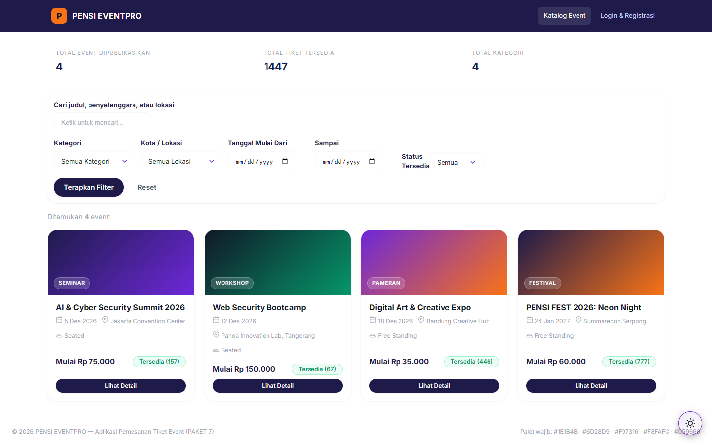
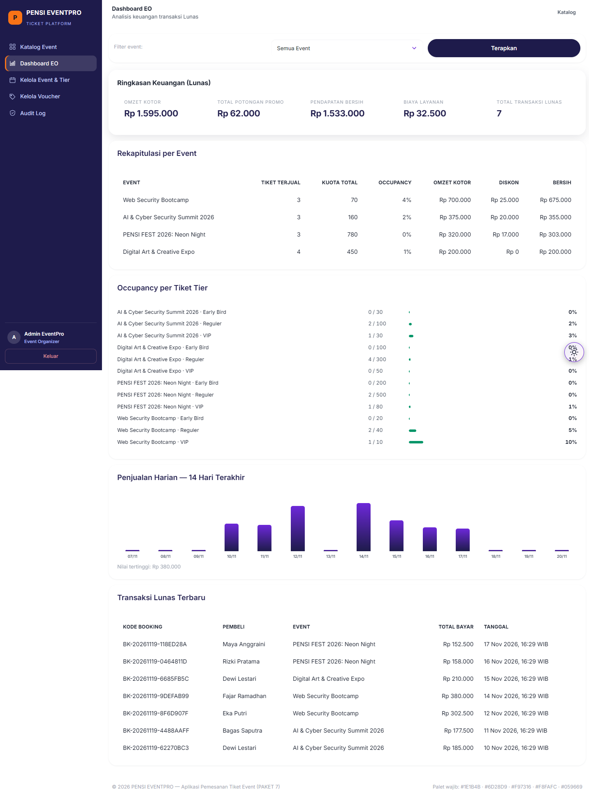
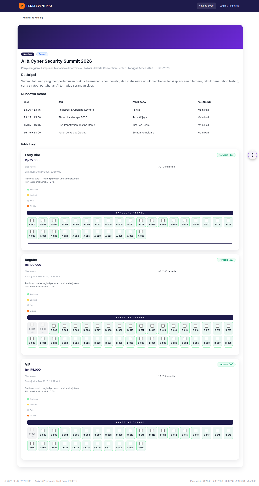
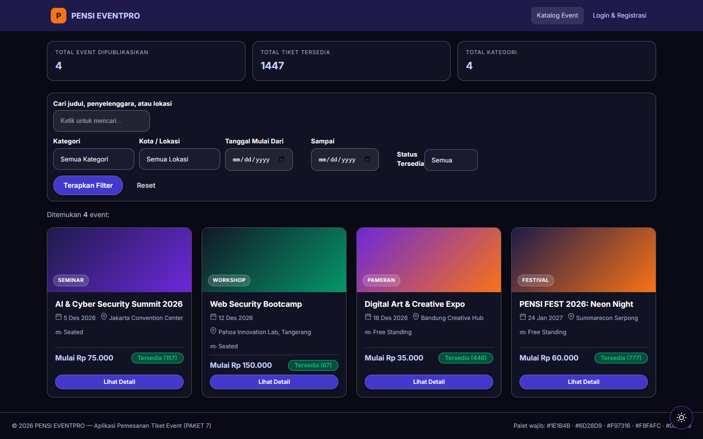
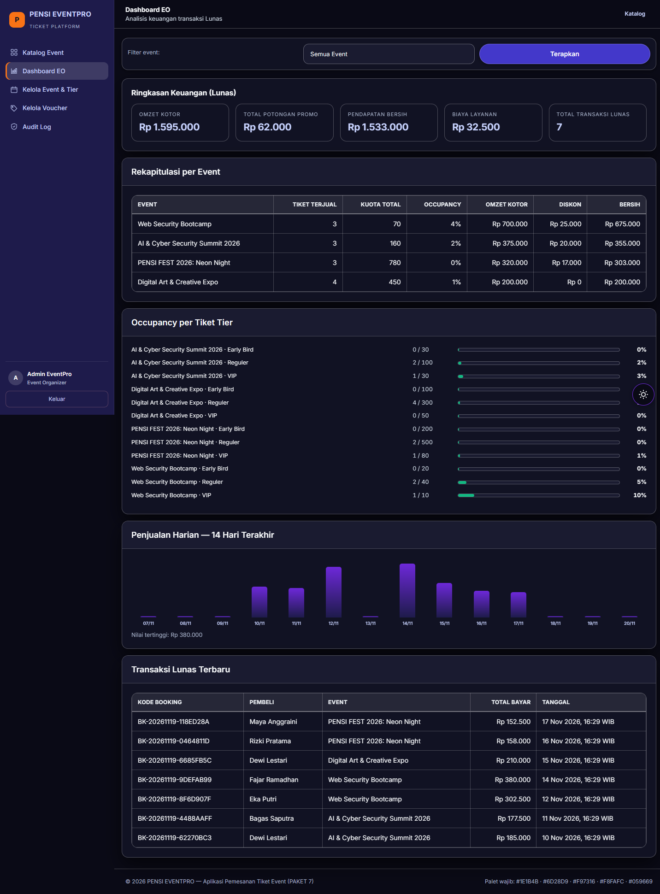
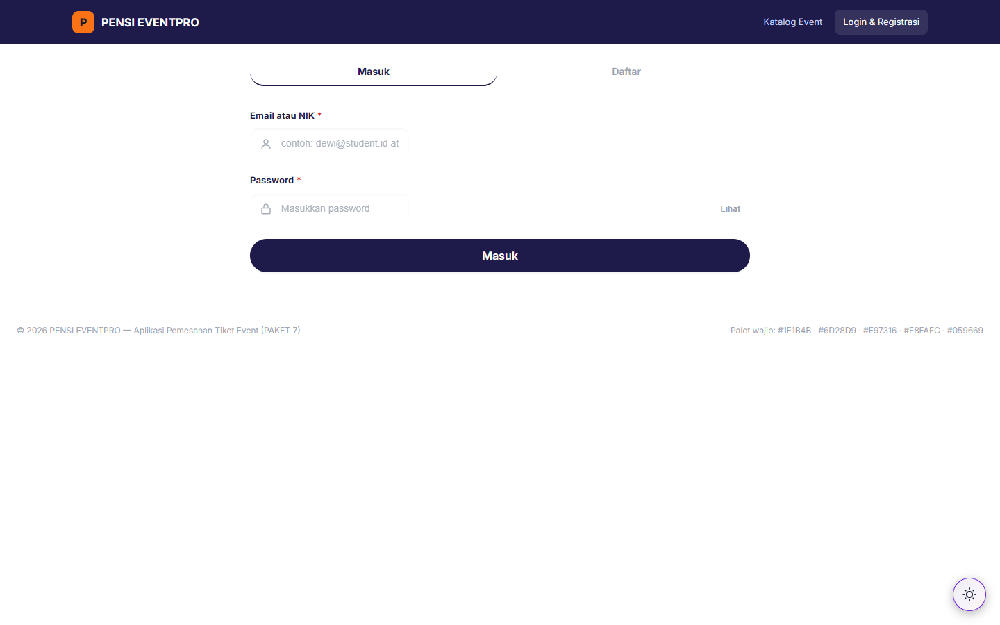
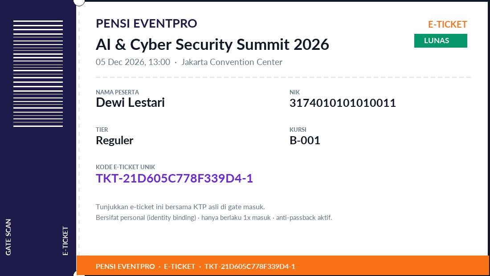

# PENSI EVENTPRO — Multi-Event Ticketing Platform (PAKET 7)

Native **PHP 8.2 + MariaDB** ticketing platform: multi-event catalog, seat/quota locking, conditional vouchers, 4-role RBAC, and e-tickets with vertical barcodes — wrapped in a 10-theme UI.

Informatics final project report (rubric mapping, business rules, version archive): [`FINAL_PROJECT.md`](FINAL_PROJECT.md).







## Features

- **Multi-event catalog** — filter by category, city, date range, quota status + real-time search
- **Event detail** — rundown, tier quotas & sale deadlines, interactive seat map (Seated) or quantity (Free Standing)
- **4 roles** — `customer`, `admin_eo`, `finance`, `gate_officer`, bcrypt cost-12 + RBAC middleware
- **Identity binding** — unique participant name + NIK per sheet, max 5 tickets per event per NIK
- **Conditional vouchers** — percent or nominal, minimum spend, usage quota, expiry
- **Checkout** — subtotal / discount / service fee / total, 15-minute countdown, proof upload
- **Payments** — bank transfer (BCA) or cash, verified by finance
- **E-tickets** — issued only after `Paid`; JPG (1100×620) and PDF (A4 landscape), vertical barcode, unique code + NIK
- **Gate check-in** — code + NIK validation, anti-passback with previous time and officer
- **EO analytics** — gross, discounts, net, fees, occupancy per tier, 14-day chart
- **Admin** — event/tier CRUD, seat generator, voucher manager, audit log
- **UI** — 10 themes (5 dark / 5 light), indigo sidebar, custom controls, proof modal, accessible tables

| Dark theme | EO dashboard |
|---|---|
|  |  |

| Login | E-ticket |
|---|---|
|  |  |

## Tech stack

- PHP 8.2 (native — no framework, no Composer)
- MariaDB 10.4+ / MySQL 8 — `db_tiket_event_pro` (9 graded tables + support tables)
- Apache 2.4 + `.htaccess` hardening (XAMPP-compatible)
- Vanilla JS, CSS custom properties, GD + FreeType for ticket rendering

## Structure

```
public/        DocumentRoot — pages, assets, themes, fonts, uploads
src/
  Config/      PDO connection, constants, HMAC secret
  Middleware/  session security, CSRF, RBAC, expiry, voucher & limit logic
  Views/       sidebar layout, footer, 403
database/      schema.sql (official schema), seed.php
tests/         functional_test.php — 32 checks
docs/          test accounts, deployment, user guide, screenshots
designs/       10 theme folders (CSS + summaries)
```

## Quick start (XAMPP)

```bash
# 1. Put the project at C:\xampp\htdocs\pensi-eventpro
# 2. Point Apache DocumentRoot at .../public (or open /pensi-eventpro/public/)
# 3. Create the database
mysql -u root < database/schema.sql
php database/seed.php

# 4. Run tests
php tests/functional_test.php      # 32 PASS
```

Portable one-command installer (from the `v6.1-portable` tag): `php install/install.php --user=root --pass=`.

Demo accounts (password `password123`): `admin.eo@eventpro.id`, `finance@eventpro.id`,
`gate@eventpro.id`, `dewi@student.id`. Full list: [`docs/TEST_ACCOUNTS.md`](docs/TEST_ACCOUNTS.md).

## Windows one-click installer

Download [`PENSI_EVENTPRO_v6.2_PORTABLE.zip`](https://github.com/Willsoll/pensi-ticketing-final-project/releases/tag/v6.2-portable)
(25 MB): run `PENSI_EVENTPRO_Setup.exe`, choose XAMPP or Laragon, and it installs
the app, imports the database, starts Apache/MySQL, and opens the site.

## Security

- bcrypt cost-12, automatic rehash, session ID regeneration on login
- Login throttling (5 attempts / 15 min), generic errors, timing-equalised dummy hash
- Prepared statements (`EMULATE_PREPARES=false`), output escaping, CSRF on every POST
- Upload MIME sniffing + size cap + random names, PHP execution blocked in `uploads/`
- Security headers, `SameSite=Strict` cookies, audit log
- PHP2Shell (CVE-2024-4577) mitigated at application layer; upgrade PHP ≥ 8.2.35 recommended

## Mandat CEO rules

1. 15-minute stock locking; expiry restores stock, seats, and voucher usage
2. Max **5 tickets per event per NIK** across transactions
3. Distinct participant name **and** NIK on every sheet
4. Voucher requires subtotal ≥ minimum, remaining quota, and valid date
5. E-ticket 1-to-many, issued only after `Paid`
6. Gate validates code + NIK; repeat scan rejected (anti-passback)

## Version history

| Tag | Milestone |
|---|---|
| `v1.0-hardened` | First flat-PHP build + security audit (27 fixes) |
| `v2.0-working` | `public/` + `src/` restructure |
| `v3-ten-designs` | Design system + 10 themes + e-ticket JPG/PDF |
| `v4-multievent` | Rewrite to `db_tiket_event_pro`, multi-event, 12 pages |
| `v5-ui-accessibility` | Borders, table grid, dark-mode contrast, custom forms |
| `v6-payments-eticket` | Train-ticket e-ticket, cash/transfer, proof modal |
| `v6.1-portable` | Portable installer, bundled fonts, env-driven setup |

Legacy branches: `legacy/php-flat-template` (original flat app) and `legacy/mvc-rewrite` (MVC experiment).

Full iteration list (base template → v6.1, with tags and dates): [`CHANGELOG.md`](CHANGELOG.md).

## Notes

Academic project. Not production-ready without infrastructure upgrades (PHP ≥ 8.2.35,
Apache ≥ 2.4.59, MariaDB ≥ 10.11) and replacing demo credentials.
